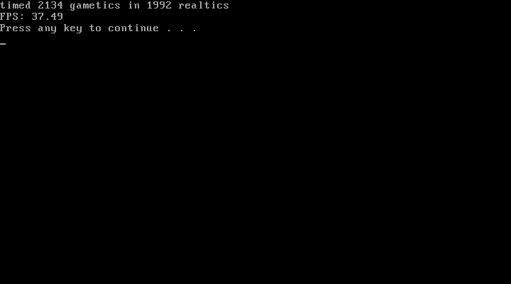
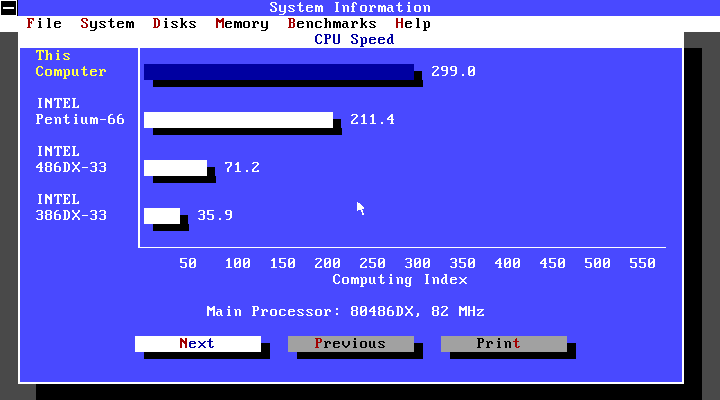
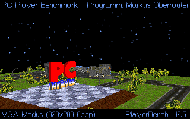
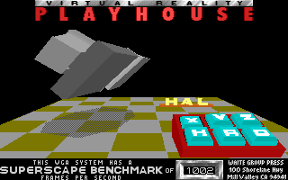
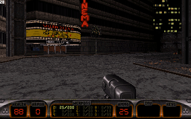

# ao486 TetriumSX for MiSTer

ao486 with its CPU replaced by [Tetrium](https://github.com/ZbuntowanyKamulec/Tetrium): about
2-3x as fast as stock ao486 in most programs. Integer only (no FPU), like a 486SX. Everything
else (BIOS, VGA, sound, disks, OSD) is ao486's, and the ao486 README below still applies.

## Installation

- Copy `ao486_TetriumSX_<date>.rbf` (and/or the overclocked `ao486_TetriumSX_OC_<date>.rbf`)
  from `releases` to `_Computer` on the SD card.
- Copy [boot0.rom](releases/boot0.rom) to `games/ao486`. The BIOS must be from 2026-11-20 or
  newer: with an older one, programs that use the BIOS wait function hang (e.g. Windows 98 at
  the code page screen). Stock ao486 works with the new BIOS too.

The core uses ao486's folder and settings file, but keeps its own CPU Clock and L2 Cache
settings, so stock ao486's settings are not affected.

## Settings

- CPU Clock (main menu): 69, 35, 17 or 8.7 MHz
- L2 Cache (Hardware): On / Off

For games that need a slower PC than 8.7 MHz, or L1 cache off, use stock ao486 (same files).

## Overclocked build

`ao486_TetriumSX_OC` runs the CPU at 82 MHz instead of 69 MHz (CPU Clock: 82, 41, 20 or 10 MHz).
Performance scales with the clock, so it is about 18% faster than the 69 MHz build. It does not
meet Quartus timing at 82 MHz, so it may be unstable on some boards; it passed a 3-hour hwstress
run on one. If something crashes, try the 69 MHz build before reporting it.

## Performance

Stock ao486 (90 MHz) and TetriumSX (69 MHz) on the same MiSTer. Code that runs from the CPU's
caches gains the most; memory, video and disk access are still ao486's, so programs that spend
much of their time on them gain less. Most programs fall between the first and the last row.

| Program | ao486 | TetriumSX | |
|---|---|---|---|
| Duke Nukem 3D, 320×200, default settings | 16 FPS | 28 FPS | 1.75× |
| Doom 1.9, `-timedemo demo3`, high detail, full screen | 20.92 FPS | 37.49 FPS | 1.8× |
| CPU-Z 1.04 Vintage Edition, Windows 98 SE | ~34 | ~101 | 3× |
| System Information (Norton Utilities), CPU speed index | 69 | 299 | 4.3× |

<table>
<tr>
<td> Doom 1.9, demo3: 37.49 FPS</td>
<td> System Information: 299 (it estimates the clock from a timing loop, hence "82 MHz")</td>
</tr>
<tr>
<td> PC Player Benchmark, VGA: 16.3 FPS</td>
<td> 3DBench 1.0c: 100.1 FPS</td>
</tr>
<tr>
<td> Duke Nukem 3D: 28 FPS (top left)</td>
<td></td>
</tr>
</table>

## Reporting bugs

Open an issue here only if the problem happens on the standard 69 MHz build and stock ao486
handles the same program correctly (same BIOS, disk image and settings). If stock ao486 fails
too, it's an ao486 issue: report it to [ao486_MiSTer](https://github.com/MiSTer-devel/ao486_MiSTer/issues).

## Source

- `rtl/tetrium`: the CPU, a subtree of the [Tetrium](https://github.com/ZbuntowanyKamulec/Tetrium)
  repository. CPU changes go there, then:
  `git subtree pull --prefix=rtl/tetrium https://github.com/ZbuntowanyKamulec/Tetrium main --squash`
- `rtl/tetrium_ao486.sv`: connects the CPU to the ao486 system; `rtl/cache/l2_cache.v` has a
  64-bit CPU port.
- `sim/tetrium`: Verilator simulation of the whole system.
- The OC build differs only in the PLL output (`rtl/pll/pll_0002.v`: c0 hi/lo 6/5, 81.82 MHz)
  and the clock tables and CPU Clock names in `ao486.sv` (81818181, `'h20605`).

Build with Quartus 17.0, see "Building core" below.

## Credits and license

ao486 by Aleksander Osman, MiSTer port by Sorgelig and contributors. Tetrium by
ZbuntowanyKamulec, written largely with Claude (Anthropic) and verified by lockstep testing
against 86Box and on hardware. The core is distributed under GPL-3.0-or-later; see `LICENSE`.

---

# ao486 port for MiSTer by Sorgelig.

MiSTer port of the ao486 core originally written by Aleksander Osman, which has been greatly reworked with many new features and performance added.

Original Core [repository](https://github.com/alfikpl/ao486)

## Features:
* TetriumSX CPU at 69 MHz, about 2-3x the speed of ao486's CPU (no FPU).
* 256MB RAM
* SVGA with up to 1280x1024@256, 1024x768@64K, 640x480@16M resolutions
* Sound Blaster 16 (DSP v4.05) and Sound Blaster Pro (DSP v3.02) with OPL3 and C/MS
* High speed UART (3Mbps) internet connection
* MIDI port (dumb and fake-smart modes)
* External MIDI device support (MT32-pi and generic MIDI)
* 4 HDDs with up to 137GB each
* 2 CD-ROMs
* Shared folder support

## How to install

* Copy the .rbf to the _Computer folder on your SD card (see Installation at the top).
* Create games/ao486/ directory on SD card and copy [boot0.rom](https://github.com/MiSTer-devel/ao486_MiSTer/blob/master/releases/boot0.rom), [boot1.rom](https://github.com/MiSTer-devel/ao486_MiSTer/blob/master/releases/boot1.rom) there.
* For CD images, the typical location is games/ao486/cd/ and you can either have the game folders, or CHD, IMG, ISO, BIN/CUE files in the root for mounting.  The imgset command can be used in DOS to mount/unmount images placed here by passing the exact path.
* For floppy: copy desired floppy raw image with extension **img** to games/ao486/floppy/ directory.  The imgset command can be used in DOS to mount/unmount images placed here by passing the exact path.
* For HDD: create an empty file of desired size with extension **vhd** in ao486 directory (or prepare .vhd file separately with any tool supporting .vhd or hard disk .img files and copy to games/ao486/ folder)
* Boot ao486 and in OSD choose desired floppy, hdd, cd, and boot order.  A valid DOS or supported OS boot is required for the core to boot an OS.  Typical use cases: DOS Install disks on floppy with a clean VHD mounted for HDD. Pre-configured VHDs with OS and programs, Boot CDs, etc.
* Save settings and press "Reset and apply HDD"
* Optional shared folder can be used in conjuction with [MisterFS.exe](https://github.com/MiSTer-devel/ao486_MiSTer/blob/master/releases/drv/misterfs.exe) running as a TSR in your DOS image to exchange files between games/ao486/shared from inside DOS.

HDD image is a raw image with MBR. It can be opened in Windows/Linux by many applications,
so it's possible to prepare a HDD in windows/linux (in most cases you need to work with .img files, then just rename it to .vhd extension)

### Core Speed and Options and Drivers
The default CPU clock is 69MHz with the L2 cache enabled.  Some games, especially older games, are sensitive to speed and cache so you can change the CPU clock and cache to fit the game.
Optionally you can use the sysctl.exe program to automatically change these settings before launching your game.  This is especially useful for batch scripts where you want to change those options and then set it back after the game exits.

Core options:
* CPU Clock (main menu): 69MHz, 35MHz, 17MHz, 8.7MHz (69MHz)
* L2 Cache (Hardware): On, Off (On)
* RAM Size (Hardware): 256MB, 16MB (256MB)

Optional programs and drivers:  https://github.com/MiSTer-devel/ao486_MiSTer/tree/master/releases/drv
* MISTERFB.DRV/INF: Windows Video Driver
* imgset.exe: Used for mounting fdd, cd, and ide drives. Run 'imgset' for options.
* misterfs.exe:  You will need to copy this file to a VHD and run it using, "misterfs LETTER" where letter is the drive letter you want to mount the shared folder to.  Create a /games/ao486/shared folder and copy files named to the 8.3 filename standard (SFN - short filename). This allows for file copy from the shared folder and accessable from within dos on a mounted drive.  The tool is basic so it should be mainly used for file copy and not for running programs.
* modem9x.inf: Used for Windows modem setup.
* mpuctl.exe: tool for sending commands to the optional mt32-pi baremetal synth.  See reference below.
* sbctl.exe: set Sound Blaster configs.  Supported: I5,I7,I10,H5,H1,T4,T6
* sysctl.exe: Used for setting core options and cache referenced above from command line. Usase: SYSCTL SYS/MENU 90Mhz/56Mhz/15Mhz L1+/L1- L2+/L2-  (with TetriumSX: 90/56/30/15 select a CPU clock of 69/35/17/8.7 MHz; L1 has no effect)

### Gravis UltraSound
Default config: baseport=240, IRQ1=7, IRQ2=7, DMA1=7, DMA2=7. (SET ULTRASND=240,7,7,7,7)
If you changed(sbctl.exe tool) SB IRQ to 7, GUS IRQ1&2 changed to 5.
Supported GUS 1MB DRAM(required SDRAM module). Any CPU clock setting.

### Sound Blaster
Default config: A220 I5 D1 H5 T6
Supported alternative configs with IRQ 7 or 10 and/or no-HDMA (16bit DMA through 8bit DMA).
Standard SB16 config (diagnose) can be used to set alternative settings, or included sbctl util. Windows driver manages alternative settings by itself when manually configured.

Current implementation supports SoundBlaster Pro specific commands (not available in SB16 originally) as well. Compatible config for SBPro is "A220 I5 D1 T4" in case if some game will require it.

ASP/CSP is not implemented, but some specific commands with dummy replies are added to let Windows driver work.

Simple volume (only master volume) is implemented in mixer so windows volume can be used in additional to standard MiSTer volume control.

### C/MS Audio
C/MS (dual SAA1099) can be enabled in OSD. When enabled it prevents OPL2/3 access on ports 220-223. OPL2/3 still can be accessed on ports 388-38B (AdLib).

### OPL2/3 (Adlib)
OPL2/3 can be accessed as a part of Sound Blaster board at ports 220-223 (if C/MS is not enabled) and 228-229(OPL2 only). However it's recommended to use AdLib ports 388-38B instead.

### MIDI settings:
* address: 330h
* IRQ: 9

### MT32-pi support:
[MT32-pi](https://github.com/dwhinham/mt32-pi) connection is supported through USER I/O port. MT32-pi is automatically detected.
Supported straight and crossed RX<->TX cables.

MT32-pi config and settings are [here](https://github.com/dwhinham/mt32-pi/wiki/MiSTer-FPGA-user-port-connection).

MT32-pi interface board is on [Hardware repository](https://github.com/MiSTer-devel/Hardware_MiSTer)

LCD and buttons are for convenience but not required. Basically only USER I/O connector is required, so it can be assembled without interface board.

### Note:
* Press **WIN+F12** to access **OSD on ao486 core**. F12 alone acts as generic F12 PC key.

### CD-ROM
Currently only data portion of CD is supported. Best image format is ISO, but BIN/CUE and CHD format discs still can be mounted. You just need to mount bin file or if it's multi-file image, then usually first track is data which you need to mount.

IDE 1-0 has special function - it's a placeholder for CD. So you can hot-swap CD images in this drive. Regardless special function this drive also supports HDD images. Once HDD image is loaded upon reboot this drive loses CD placeholder feature.

### Hard Disk and CD-ROM in Windows
Core supports up to 4 HDD images up to 137GB each. Up to 2 CD-ROMs are supported.

Currently due to unknown source of issue Windows works with IDE devices through BIOS. Most likely some BIOS function doesn't supply correct info for Windows drivers.
It doesn't prevent windows from working but you need to keep in mind some specifics:
* Hard disks mounted on Primary IDE (0-0/0-1) need no attentions. They simply work.
* Driver for Secondary IDE (1-0/1-1) have yellow mark. It's recommended to delete this device from device list - it's not used anyway but will be installed every time you start automatic HW detection procedure.
* CD-ROM needs oakcdrom.sys and mscdex.exe added to config.sys and autoexec.bat respectively (you may find them on bootable Window98 CD). Windows will use it to access CD-ROM.
* CD-ROM autostart won't be automatically triggered (because work through BIOS). After replacing image file in CD-ROM you need to refresh the folder with drives (F5) and icon of CD will be changed if provided by image. Autostart will be triggered when you click on CD icon.

### Building core
* Quartus 17.0 doesn't install properly on newer Linux distros, so use Docker instead. Install Docker for your dist https://docs.docker.com/engine/install/
* Download Docker image containing Quartus Lite Edition 17.0 from https://github.com/raetro/sdk-docker-fpga:

        docker pull ghcr.io/raetro/quartus:mister

* Build project
    * After cloning this repo and changing to the directory:

            docker run -it --rm -v $(pwd):/build raetro/quartus:mister quartus_sh --flow compile ao486.qpf

* Access GUI

        docker run --rm -ti --net=host --ipc=host -e DISPLAY=$DISPLAY -v /tmp/.X11-unix:/tmp/.X11-unix --env="QT_X11_NO_MITSHM=1" -v $(pwd):/build raetro/quartus:mister quartus
