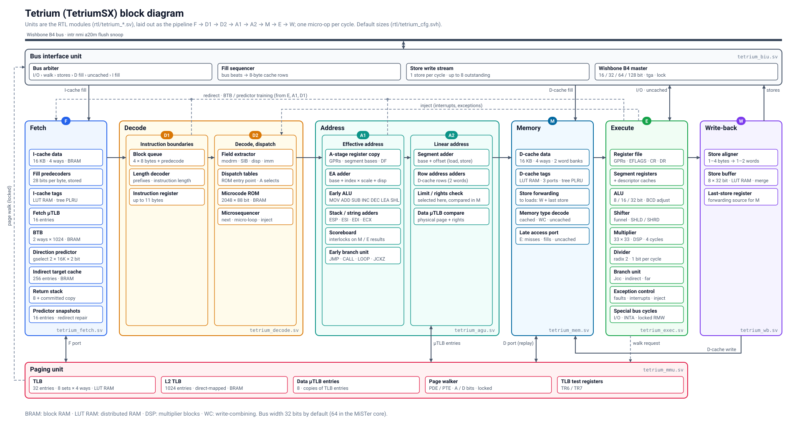

# Tetrium

A pipelined x86 CPU for FPGAs, written in SystemVerilog. It is i486-compatible, but per
clock it runs integer code well beyond an i486, into Pentium territory, hence the name: at
69 MHz it scores like a 75 MHz Pentium in CPU-Z. The current core, **TetriumSX**, is integer
only, like an i486SX.

- Real, protected and virtual-8086 mode, paging, task switching, the i486 instruction set
  (`CPUID`, debug registers, test registers `TR3`–`TR7`)
- 8-stage pipeline, branch prediction, 16 KB 4-way instruction and data caches
- Pipelined Wishbone B4 bus master, 16 / 32 / 64 / 128-bit data, with locked, I/O and
  interrupt-acknowledge cycles; cache snooping, `A20M`, `FLUSH`
- Microcode generated by `ucode/ucgen.py`; no vendor primitives (all RAMs are inferred)

## Architecture



An in-order scalar pipeline: F, D1, D2, A1, A2, M, E, W. Most instructions are one
micro-op, and one completes per cycle. The main design decisions:

- **Address work early.** A1 keeps a copy of the registers and updates `ESP`, `ESI`, `EDI`
  and `ECX` for push, pop, string and loop micro-ops, so stack and string sequences don't
  wait for E. A2 adds the segment base and checks limits. Direct jumps resolve in A.
- **Memory operands for free.** M reads the data cache in two banks, so any unaligned
  access up to 4 bytes is one read, and load + ALU op takes one cycle. Stores use a separate
  write port in W (store buffer, store-to-load forwarding), so read-modify-write also takes
  one.
- **TLB off the hit path.** The caches are virtually indexed and physically tagged (4 KB
  ways). Per-page micro-TLBs for fetch and data sit in front of an i486-organized TLB, an
  L2 TLB and a hardware page walker.
- **Microcode in block RAM**, generated from Python. Each micro-op word carries the address
  fields of its successor, keeping the ROM's latency out of the address path. Far
  transfers, gates, interrupts and task switches are micro-op sequences.
- **Precise faults.** All faults are raised in E, in program order. Registers changed by an
  earlier micro-op of the instruction (`ESP`, `SS`, ...) are restored, so every fault
  restarts cleanly.
- **Front end.** Predecode stored in the instruction cache; BTB and gselect direction
  counters in block RAM; an 8-entry return stack. Prefixes are consumed with their
  instruction. Self-modifying code follows the i486 rule (a jump after the store).

### Cycles per instruction

Cache hits, no interlocks. i486 counts are from Intel's data sheet (cache hit). Numbers in
the first column point to the notes below.

| Instruction | Tetrium | i486 |
|---|---|---|
| `MOV`, ALU op `reg, reg` / `reg, imm` ¹ | 1 | 1 |
| `MOV reg, mem` / `MOV mem, reg` ¹ ² | 1 | 1 |
| ALU op `reg, mem` ¹ ² | 1 | 2 |
| ALU op `mem, reg` (read-modify-write) ¹ ² ³ | 1 | 3 |
| `PUSH reg` / `POP reg` ⁴ | 1 | 1 |
| `MOVSX`, `MOVZX`, `SETcc`, `BT reg` ¹ | 1 | 3 |
| shift / rotate `reg, 1` | 1 | 3 |
| shift / rotate `reg, imm` / `reg, CL` | 2 | 2–3 (`RCL`, `RCR`: 8) |
| `MUL`, `IMUL`, 16 / 32-bit | 4 | 13 |
| `DIV`, `IDIV`, 16 / 32-bit | 20 / 36 | 24 / 40 |
| `XADD reg` / `CMPXCHG reg` ¹ | 1 / 3 | 3 / 6 |
| `MOV sreg, reg`, real / protected mode ⁵ | 1 / 4 | 3 / 9 |
| `MOV sreg, mem` / `LES` etc., protected mode ⁵ | 7 / 9 | 9 / 12 |
| `REP MOVS` / `REP STOS`, per element ⁶ | 1 | 3 / 4 |
| `PUSHA` + `POPA` | 17 | 20 |
| `JMP short` ⁷ | 2 | 3 |
| `CMP` + `Jcc`, taken / not taken ⁷ | 2 / 2 | 4 / 2 |
| `CALL` + `RET`, near ⁷ | 3 | 8 |
| `CALL far` + `RETF`, real mode ⁷ | 5 | 31 |
| `INT n` + `IRET`, real / protected mode | 27 / 50 | 45 / 59 |
| `XCHG mem, reg` / `LOCK` read-modify-write | 10 | 5 / 4 |

1. **Prefixes.** The first prefix byte (`66h`, `67h`, a segment override, or the `0Fh`
   opcode escape) is free; each further one adds 1 cycle. Example: `MOVZX r16, r8` in 32-bit
   code (`66h 0Fh`) takes 2.
2. **Memory operands.** A register used as an address right after it was written:
   - loaded from memory (`MOV`, `POP`): +2;
   - computed in E (e.g. `AND`, `OR`, `XOR`, shift by `CL`, `IMUL`, `MOVZX`): +3;
   - written by `MOV reg, reg`, `ADD`, `SUB`, `INC`, `DEC`, `LEA` or `SHL` by 1–3: no delay
     (these execute early, in A).

   A store crossing a 32-byte line: +1.
3. **Same location.** Reading the location the previous instruction wrote: +1 (the store is
   forwarded one cycle late).
4. **Stack.**
   - `POP`, or a load from the stack, right after a `PUSH` to the same slot: +1;
   - `ESP` computed in E (e.g. `AND ESP, imm`), then `PUSH` / `POP`: +3;
   - `ADD ESP`, `SUB ESP` and `MOV ESP, reg`: no delay.
5. **Segment loads.** The next memory access through the new segment: +3.
6. **String start-up.** About 2 cycles before the first element.
7. **Branch prediction.** Correctly predicted (BTB, direction predictor, return stack). A
   mispredicted branch: +8.

`tests/clocks.py` measures every form.

## FPGA implementation results

| FPGA | Tool | fmax | Logic | RAM | DSP |
|---|---|---|---|---|---|
| Artix-7 (`xc7a100t-1`) | Vivado 2025.2, implementation | 95.1–98.0 MHz | 23.8k LUTs (2.4k as RAM), 11.5k FFs | 31 BRAM36 | 4 |
| Cyclone V (`5CSEBA6U23I7`) | Quartus 17, fit (worst corner) | 85.1–87.0 MHz | 20.0k ALMs, 13.4k registers | 139 M10K, 90 kbit MLAB | 3 |

The CPU alone (I/O as virtual pins), maximum-performance settings, three runs each
(Quartus seeds, Vivado placer directives).

## Performance

In simulation (32-bit flat protected mode, warm caches; gcc 13
`-O2 -march=i386 -mno-80387`):

| Benchmark | Per MHz | CPI |
|---|---|---|
| Dhrystone 2.1 | 0.833 DMIPS/MHz | 1.17 |
| CoreMark (2K performance run) | 2.309 CoreMark/MHz | 1.26 |

Dhrystone uses the source and settings of z486's Dhrystone comparison. `tests/perf.sh`
reproduces both.

On a MiSTer (ao486-based core, CPU at 69.23 MHz):

| Benchmark | Result |
|---|---|
| Doom 1.9, `-timedemo demo3`, high detail, full screen | 37.55 FPS |
| 3DBench 1.0c | 99.9 FPS |
| CPU-Z 1.04 Vintage Edition, Windows 98 SE | 101.5 (Pentium 75 reference: 98.0) |

## Interface

`rtl/tetrium_top.sv`:

- `clk`, `rst`
- Wishbone master `wb_*`; `wb_tga` marks memory, I/O and interrupt-acknowledge cycles,
  `wb_lock` locked sequences
- `intr`, `nmi`, `a20m`, `flush`
- `snoop_v`, `snoop_line`: invalidate a cache line (DMA)
- `cflush`: one-cycle pulse on `INVD` and `WBINVD` (flush external caches); `cwback`: on
  `WBINVD`, write them back first
- `halted`, `shutdown` (triple fault)

Parameters set the bus width, cacheable and write-combining regions, the reset CS base and
`CR0`, the CPU signature, `CPUID` and the debug registers. Cache and TLB sizes are in
`rtl/tetrium_cfg.svh`.

## Verification

The testbench runs the core in lockstep with the [86Box](https://github.com/86Box/86Box)
CPU interpreter and compares every retired instruction. 86Box is patched where it differs
from a real 486 (`tb/x86ref/86box-486.patch`).

```sh
tests/fetch.sh      # 86Box, test386.asm and SingleStepTests/80386 into ref/
tests/conv386.sh    # convert the SingleStepTests
make sim            # Verilator testbench (Verilator 5)
make test           # SingleStepTests/80386, real mode
tests/test386.sh    # test386.asm in lockstep
tests/pm.sh         # protected-mode and paging directed tests
tests/rlock.sh      # random programs in lockstep (PM=1: protected mode, PG=1: paging)
tests/lock.sh       # benchmarks and directed tests in lockstep
tests/clocks.py     # cycles per instruction form, against the i486
tests/perf.sh       # Dhrystone and CoreMark
```

`tests/hwstress` is a bootable stress test for a complete PC built around the CPU.

## License

GPL-3.0-or-later, see `COPYING`. CoreMark and Dhrystone in `bench/c` keep their own licenses.

Design, requirements and verification direction by ZbuntowanyKamulec. Most of the code was
written with Claude (Anthropic) and verified by lockstep testing against 86Box and on
hardware.
